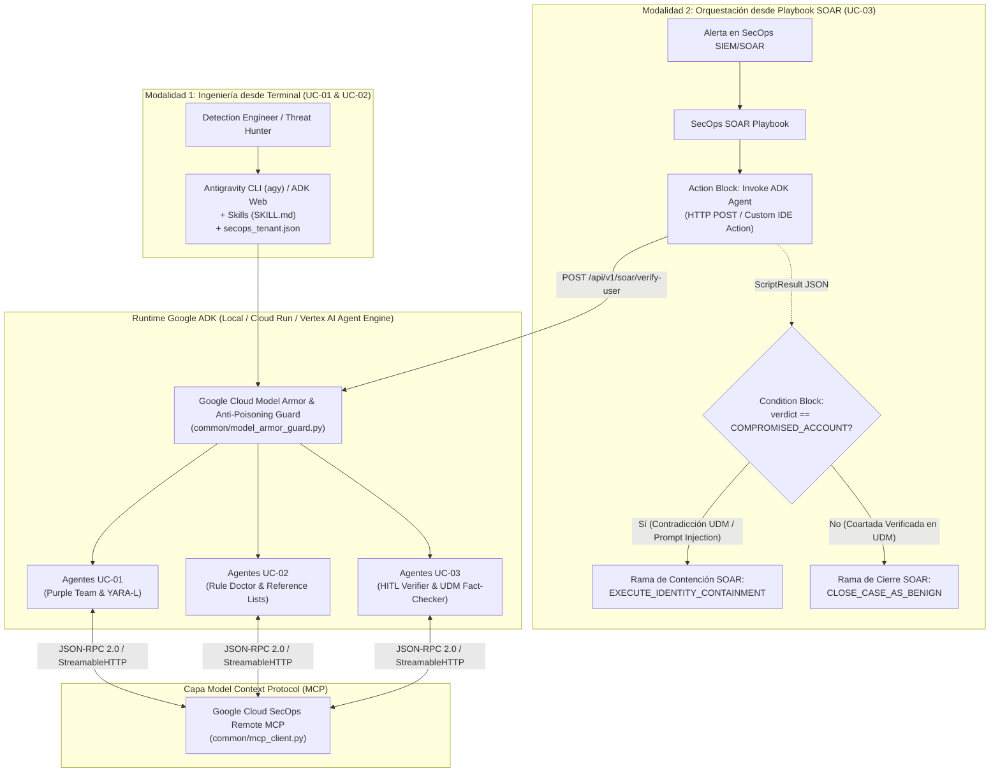

# 🛡️ Google Cloud SecOps — Suite de Demos de SOC Agentic AI (ADK + Antigravity CLI `agy` + Remote MCP + SOAR Playbooks)

Documentación maestra y guía de inicio rápido (*Quickstart*) para los **3 Casos de Uso Core de Operaciones de Seguridad (SOC)** construidos con **Google Agent Development Kit (ADK)**, **Antigravity CLI (`agy`)**, **Google Cloud SecOps (SIEM & SOAR)** mediante su servidor **Remote MCP**, y **Google Cloud Model Armor**.

> [!IMPORTANT]
> **Política de Cero Datos Hardcodeados (*Zero-Hardcoding*):**
> Ningún archivo de código ni de documentación en este repositorio contiene identificadores de proyecto reales, UUIDs de clientes de Chronicle, cuentas de correo personales, IDs de reglas fijos ni rutas absolutas locales. Toda la configuración del tenant se inyecta en tiempo de ejecución mediante variables de entorno o el archivo local `./secops_tenant.json` (excluido en `.gitignore` y generado a partir de [`./secops_tenant.example.json`](./secops_tenant.example.json)).

---

## 📋 1. Resumen Ejecutivo de los 3 Casos de Uso

| ID | Caso de Uso | Directorio | Modalidad de Ejecución | Objetivo Técnico Principal |
| :--- | :--- | :--- | :--- | :--- |
| **UC-01** | **Autonomous Purple Team & Detection-as-Code** | [`./uc01_purple_team_agent/`](./uc01_purple_team_agent/) | `agy` CLI / `adk web` / `python3 -m uc01_purple_team_agent.demo_cli` | Ingerir un boletín de inteligencia de amenazas (CTI) o técnica MITRE ATT&CK (ej. `T1003.001` volcado de LSASS vía `rundll32.exe` + `comsvcs.dll`), extraer oportunidades de detección (*TDO*), generar telemetría UDM sintética, evaluar brechas de cobertura contra el corpus actual de reglas del SIEM y compilar/desplegar reglas YARA-L 2.0 validadas. |
| **UC-02** | **SecOps Health & Rule Optimization Doctor** | [`./uc02_rule_doctor_agent/`](./uc02_rule_doctor_agent/) | `agy` CLI (`/secops-doctor`) / `adk web` / `python3 -m uc02_rule_doctor_agent.demo_cli` | **Rama A (Rendimiento):** Auditar reglas YARA-L con errores de ejecución/timeout o anti-patrones de consulta (`list_rule_errors`, `list_rules`) y optimizarlas automáticamente.<br>**Rama B (Tuning de Falsos Positivos):** Analizar casos cerrados en SOAR (`list_cases` + `list_case_comments`), aplicar guardrails *Anti-Poisoning* y actualizar *Reference Lists* (`%authorized_ci_cd_runners`). |
| **UC-03** | **Conversational User Verifier (HITL) con Verificación Cruzada UDM & Model Armor** | [`./uc03_soar_hitl_verifier/`](./uc03_soar_hitl_verifier/) | **Playbook de Google SecOps SOAR** $\rightarrow$ Webhook FastAPI (`POST /api/v1/soar/verify-user`) / `python3 -m uc03_soar_hitl_verifier.demo_simulator` | **Invocado automáticamente desde un Playbook de Google SecOps SOAR.** Recolecta la verdad forense oculta en SIEM (`udm_search`), entrevista al usuario por Chat protegiendo contra *Prompt Injection* con **Model Armor**, contrasta la coartada del usuario contra los logs UDM en tiempo real, documenta el dossier en el *Case Wall* (`create_case_comment`) y devuelve un `ScriptResult` estructurado al Playbook para ejecutar contención (`COMPROMISED_ACCOUNT`) o cerrar el caso (`VERIFIED_BENIGN`). |

---

## 🏛️ 2. Arquitectura General

La solución integra dos patrones operativos complementarios sobre una misma capa de protocolo (**Model Context Protocol - MCP**) y protección (**Google Cloud Model Armor**):

1. **Patrón 1 — Ingeniería de Detección y Optimización desde Terminal (`UC-01` y `UC-02`):**
   El ingeniero de detección opera desde **Antigravity CLI (`agy`)**, **ADK Web** o los ejecutores CLI para automatizar el ciclo de vida de reglas YARA-L 2.0 y listas de referencia contra el servidor **Google Cloud SecOps Remote MCP**.
2. **Patrón 2 — Orquestación Event-Driven desde Playbooks de SecOps SOAR (`UC-03`):**
   Cuando ingresa una alerta a **Google Cloud SecOps SOAR**, el Playbook invoca vía HTTP Webhook (`POST /api/v1/soar/verify-user`) o mediante una *Custom Action* del IDE de SOAR al sistema multi-agente ADK. El agente investiga vía MCP, entrevista al usuario filtrando ataques adversarios con **Model Armor**, actualiza el caso en SOAR y retorna la decisión de ramificación al Playbook.



---

## 📂 3. Estructura del Proyecto

```text
./
├── README.md                         # Documentación maestra en Español (este archivo)
├── UseCaseDiscovery.md               # Discovery funcional y caso de negocio para el SOC
├── UseCasesSpec.md                   # Especificación de arquitectura, diagramas y contratos JSON
├── secops_tenant.example.json        # Plantilla parametrizada de configuración del tenant
├── secops_tenant.json                # Configuración activa local (ignorada por .gitignore)
├── mcp_config.example.json           # Plantilla de configuración MCP para ~/.gemini/config/mcp_config.json
├── requirements.txt                  # Dependencias Python (google-adk, fastapi, uvicorn, etc.)
├── .gitignore                        # Protege secops_tenant.json y artefactos locales
├── common/
│   ├── __init__.py
│   ├── mcp_client.py                 # Cliente JSON-RPC / ADK McpToolset + Mock determinista
│   ├── model_armor_guard.py          # Sanitizador Prompt Injection / Model Armor + Anti-Poisoning
│   └── mcp_config.example.json       # Ejemplo de configuración MCP
├── uc01_purple_team_agent/           # UC-01: Autonomous Purple Team & Detection-as-Code
│   ├── __init__.py
│   ├── agent.py                      # Pipeline multi-agente ADK (TDO -> UDM Sintético -> Cobertura -> YARA-L)
│   ├── demo_cli.py                   # Ejecutor CLI para modo Mock y modo Live (--live)
│   ├── sample_cti_report.md          # Reporte CTI de ejemplo (LSASS Dump MITRE T1003.001 + T1053.005)
│   ├── SKILL.md                      # Skill para Antigravity CLI (agy)
│   └── README.md                     # Documentación específica de UC-01
├── uc02_rule_doctor_agent/           # UC-02: SecOps Health & Rule Optimization Doctor
│   ├── __init__.py
│   ├── agent.py                      # Auditor de reglas lentas (Rama A) y tuning de FPs (Rama B)
│   ├── demo_cli.py                   # Ejecutor CLI para modo Mock y modo Live (--live)
│   ├── SKILL.md                      # Skill (/secops-doctor) para Antigravity CLI (agy)
│   └── README.md                     # Documentación específica de UC-02
├── uc03_soar_hitl_verifier/          # UC-03: Playbook SOAR -> Invoca Agente ADK HITL Verifier
│   ├── __init__.py
│   ├── agent.py                      # Perfilador UDM + Entrevistador HITL + Verificador de Coartadas
│   ├── server.py                     # Microservicio FastAPI (POST /api/v1/soar/verify-user)
│   ├── demo_simulator.py             # Simulador de los 3 escenarios del Playbook SOAR (Mock y --live)
│   ├── soar_playbook/
│   │   ├── soar_custom_action_ide.py # Script para el IDE de Google SecOps SOAR
│   │   ├── playbook_definition.json  # Definición declarativa del Playbook y sus ramas
│   │   └── PLAYBOOK_SETUP.md         # Guía de integración en Google SecOps SOAR
│   └── README.md                     # Documentación específica de UC-03
└── tests/
    ├── test_all_use_cases.py         # Suite de pruebas unitarias e integración determinista
    └── test_live_secops.py           # Suite de validación en vivo contra Google Cloud SecOps MCP
```

---

## ⚙️ 4. Configuración Parametrizada (Sin Datos Hardcodeados)

### 4.1. Instalación de Dependencias

```bash
pip install -r requirements.txt
```

> [!TIP]
> **Modo de Simulación Determinista (`SECOPS_MOCK_MODE=true`):**
> Todos los agentes y ejecutores CLI cuentan con una capa de simulación determinista integrada en [`./common/mcp_client.py`](./common/mcp_client.py). Esto permite ejecutar y probar los 3 casos de uso de extremo a extremo de forma inmediata sin necesidad de conexión externa, o alternar al modo **Live (`--live` / `SECOPS_MOCK_MODE=false`)** contra un tenant real de Google Cloud SecOps.

### 4.2. Configuración del archivo local `secops_tenant.json`

Copia la plantilla [`./secops_tenant.example.json`](./secops_tenant.example.json) a `./secops_tenant.json` y completa los placeholders con los valores de tu entorno:

```bash
cp secops_tenant.example.json secops_tenant.json
```

Estructura de `./secops_tenant.example.json`:
```json
{
  "customer_id": "<YOUR_CHRONICLE_CUSTOMER_UUID>",
  "project_id": "<YOUR_GCP_PROJECT_ID>",
  "region": "us",
  "gcp_region": "us-central1",
  "account": "<YOUR_GCLOUD_ACCOUNT>",
  "mcp_endpoint": "https://chronicle.us.rep.googleapis.com/mcp"
}
```

> [!NOTE]
> El archivo `./secops_tenant.json` está incluido en [`.gitignore`](./.gitignore) para garantizar que nunca se suban credenciales o identificadores de tu tenant al control de versiones.

### 4.3. Variables de Entorno Soportadas

La función `load_tenant_context()` en [`./common/mcp_client.py`](./common/mcp_client.py) resuelve la configuración en tiempo de ejecución dando prioridad a las variables de entorno sobre `./secops_tenant.json`:

| Variable de Entorno | Descripción | Valor por Defecto (Fallback Genérico) |
| :--- | :--- | :--- |
| `GCP_PROJECT_ID` | ID del proyecto de Google Cloud vinculado a SecOps | `your-gcp-project-id` |
| `SECOPS_CUSTOMER_ID` | UUID de la instancia (Customer ID) de Google SecOps / Chronicle | `00000000-0000-0000-0000-000000000000` |
| `SECOPS_REGION` | Región de la instancia de Google SecOps (`us`, `eu`, `asia-southeast1`, etc.) | `us` |
| `SECOPS_GCP_REGION` | Región de GCP para servicios auxiliares | `us-central1` |
| `SECOPS_GCLOUD_ACCOUNT` | Cuenta configurada en `gcloud auth` para emitir el Bearer token OAuth | `""` (usa la cuenta activa de `gcloud` o ADC) |
| `SECOPS_MCP_ENDPOINT` | URL del servidor Remote MCP de Google Cloud SecOps | `https://chronicle.us.rep.googleapis.com/mcp` |
| `SECOPS_TENANT_CONFIG_PATH` | Ruta personalizada opcional hacia el archivo `secops_tenant.json` | `./secops_tenant.json` |
| `SECOPS_MOCK_MODE` | `true` para usar el motor determinista local; `false` para invocar el MCP real | Auto-detectado según disponibilidad de token OAuth |
| `MODEL_ARMOR_TEMPLATE_ID` | (Opcional) ID de plantilla de Google Cloud Model Armor API | Si no se define, usa el motor heurístico local |

Ejemplo de configuración por variables de entorno en terminal:
```bash
export GCP_PROJECT_ID="<YOUR_GCP_PROJECT_ID>"
export SECOPS_CUSTOMER_ID="<YOUR_CHRONICLE_CUSTOMER_UUID>"
export SECOPS_REGION="us"
export SECOPS_GCLOUD_ACCOUNT="<YOUR_GCLOUD_ACCOUNT>"
export SECOPS_MCP_ENDPOINT="https://chronicle.us.rep.googleapis.com/mcp"
```

### 4.4. Configuración de Antigravity CLI (`agy`) y Permisos IAM

1. **Roles IAM requeridos en el proyecto de GCP:**
   * `roles/mcp.toolUser`
   * `roles/chronicle.admin`
   * `roles/chronicle.soarAdmin`
   * `roles/serviceusage.serviceUsageConsumer`
2. **Autenticación OAuth / Application Default Credentials (ADC):**
   ```bash
   gcloud auth login <YOUR_GCLOUD_ACCOUNT>
   gcloud auth application-default login \
     --scopes="https://www.googleapis.com/auth/cloud-platform,https://www.googleapis.com/auth/chronicle"
   ```
3. **Archivo `~/.gemini/config/mcp_config.json` para `agy` CLI:**
   Copia [`./mcp_config.example.json`](./mcp_config.example.json) a `~/.gemini/config/mcp_config.json` y reemplaza `<YOUR_GCP_PROJECT_ID>`:
   ```bash
   mkdir -p ~/.gemini/config
   cp mcp_config.example.json ~/.gemini/config/mcp_config.json
   ```
4. **Instalación Global de los Skills (`SKILL.md`) para Antigravity CLI (`agy`):**
   Para que `agy` descubra automáticamente las skills de **UC-01 (`uc01-autonomous-purple-team`)** y **UC-02 (`secops-doctor` / `/secops-doctor`)** de forma global desde cualquier directorio de tu estación de trabajo, regístralas en `~/.gemini/config/skills/` mediante enlaces simbólicos (o copia directa):

   ```bash
   # Opción A (Recomendada): Enlace simbólico global (mantiene sincronizados los cambios del repositorio)
   mkdir -p ~/.gemini/config/skills/uc01-autonomous-purple-team
   ln -sfn "$(pwd)/uc01_purple_team_agent/SKILL.md" ~/.gemini/config/skills/uc01-autonomous-purple-team/SKILL.md

   mkdir -p ~/.gemini/config/skills/secops-doctor
   ln -sfn "$(pwd)/uc02_rule_doctor_agent/SKILL.md" ~/.gemini/config/skills/secops-doctor/SKILL.md

   # Opción B (Alternativa): Copia estática en el directorio global de skills
   # cp uc01_purple_team_agent/SKILL.md ~/.gemini/config/skills/uc01-autonomous-purple-team/SKILL.md
   # cp uc02_rule_doctor_agent/SKILL.md ~/.gemini/config/skills/secops-doctor/SKILL.md

   # Verificar que ambos skills quedaron registrados globalmente:
   ls -l ~/.gemini/config/skills/*/SKILL.md
   ```

---

## 🚀 5. Guía Detallada de Ejecución de los 3 Casos de Uso

### 🟣 Caso de Uso 1 (`UC-01`): Autonomous Purple Team & Detection-as-Code

**Flujo Técnico ([`./uc01_purple_team_agent/`](./uc01_purple_team_agent/)):**
1. **`ThreatIntelToTdoAgent`**: Inspecciona el reporte de amenaza ([`./uc01_purple_team_agent/sample_cti_report.md`](./uc01_purple_team_agent/sample_cti_report.md)) con Model Armor, extrae las oportunidades de detección (*TDOs*) para `MITRE T1003.001` y `T1053.005`, y genera eventos UDM sintéticos (`udmsJson` sin doble escape).
2. **`CoverageEvaluatorAgent`**: Evalúa la cobertura del corpus de reglas del SIEM contra los eventos sintéticos y normaliza los metadatos protobuf de las reglas (`alertingEnabled: False` cuando el campo booleano viene omitido).
3. **`YaraLAuthorAndValidatorAgent`**: Genera la regla YARA-L 2.0 (`rundll32_comsvcs_lsass_memory_dump`), ejecuta un bucle de autocorrección compilándola contra `validate_rule` en el backend de SecOps, verifica que produzca `0` falsos positivos en las últimas 72 horas (`list_rule_detections`) y opcionalmente la despliega con `create_rule`.

**Comandos de Ejecución:**
```bash
# 1. Modo Demo / Simulación Determinista (sin conexión a GCP):
SECOPS_MOCK_MODE=true python3 -m uc01_purple_team_agent.demo_cli

# 2. Modo Live conectado al servidor Remote MCP de Google Cloud SecOps:
python3 -m uc01_purple_team_agent.demo_cli --live

# 3. Modo Live desplegando la nueva regla YARA-L 2.0 en el SIEM:
python3 -m uc01_purple_team_agent.demo_cli --live --deploy

# 4. Mediante Google ADK Web UI:
adk web .
```

#### 💬 Prompts de Ejemplo para `UC-01` en Antigravity CLI (`agy`)

Una vez instalado el skill globalmente en `~/.gemini/config/skills/uc01-autonomous-purple-team/SKILL.md`, inicia `agy` y utiliza cualquiera de estos prompts:

* **Prompt 1 — Ciclo Purple Team End-to-End desde Boletín CTI:**
  ```text
  Usa la skill uc01-autonomous-purple-team para ingerir el boletín ./uc01_purple_team_agent/sample_cti_report.md. Extrae las oportunidades de detección (TDO) para T1003.001 y T1053.005, genera los eventos UDM sintéticos sin doble escape JSON, evalúa qué brechas de cobertura tenemos en el SIEM y genera la regla YARA-L 2.0 validada con validate_rule.
  ```
* **Prompt 2 — Simulación Puntual de una Técnica MITRE ATT&CK y Despliegue Controlado:**
  ```text
  Ejecuta un ejercicio de Purple Team autónomo para la técnica MITRE T1003.001 (volcado de memoria de LSASS usando rundll32.exe y comsvcs.dll MiniDump / #24). Verifica si alguna regla activa con alertingEnabled=true en nuestro tenant de Google SecOps la detecta; si existe brecha de cobertura, escribe la regla YARA-L 2.0, valida su sintaxis en el backend MCP, comprueba que tenga 0 falsos positivos en las últimas 72h y despliégala en modo prueba (alertingEnabled=false).
  ```
* **Prompt 3 — Prueba del Bucle de Auto-Corrección de Sintaxis YARA-L 2.0:**
  ```text
  Con uc01-autonomous-purple-team, genera una regla YARA-L 2.0 para detectar persistencia mediante schtasks.exe /create /sc minute (T1053.005), ejecútala contra validate_rule en el servidor MCP de SecOps y muéstrame el contrato JSON final de cobertura y validación.
  ```

#### 🌐 Prompts de Ejemplo para `UC-01` en `adk web`

1. Ejecuta `adk web .` en la raíz del proyecto, abre la URL local en tu navegador (por defecto `http://localhost:8000`) y selecciona el agente **`uc01_purple_team_agent`** en el menú desplegable superior.
2. Prueba los siguientes prompts en el chat interactivo de `adk web`:

* **Prompt A — Auditoría Completa de Cobertura CTI:**
  ```text
  Analiza el reporte CTI de volcado de credenciales LSASS (T1003.001 vía comsvcs.dll) y tareas programadas (T1053.005). Genera 3 eventos sintéticos UDM PROCESS_LAUNCH, evalúa la cobertura actual de nuestras reglas en Google SecOps y compila una nueva regla YARA-L 2.0 para cubrir la brecha detectada.
  ```
* **Prompt B — Generación de Telemetría Sintética y Validación sin Despliegue:**
  ```text
  Ejecuta el pipeline de Purple Team en modo validación (deploy_rule=False) sobre el reporte de inteligencia de amenazas y devuélveme el resumen de TDOs, los eventos udmsJson generados y el resultado de validate_rule.
  ```

---

### 🩺 Caso de Uso 2 (`UC-02`): SecOps Health & Rule Optimization Doctor

**Flujo Técnico ([`./uc02_rule_doctor_agent/`](./uc02_rule_doctor_agent/)):**
1. **`RuleHealthAuditorAgent` (Rama A — Rendimiento y Errores YARA-L):**
   * Consulta `list_rule_errors` y `list_rules` para localizar reglas con fallos de ejecución o con anti-patrones costosos (ausencia de filtro `$e.metadata.event_type`, expresiones regulares sin anclar `/.*...*/` y ventanas `match:` de `24h`).
   * Reescribe la regla optimizada y verifica su compilación exitosa (`SUCCEEDED`) mediante `validate_rule`.
2. **`FalsePositiveTunerAgent` (Rama B — Tuning de Falsos Positivos y Anti-Poisoning):**
   * Analiza los casos cerrados como benignos (`list_cases` + `list_case_comments`).
   * Evalúa cada entidad candidata con `inspect_reference_list_candidate()`:
     * Autoriza y agrega hosts internos verificados (`build-runner-04`) a la lista de referencia `%authorized_ci_cd_runners` (`update_reference_list`).
     * **Bloquea automáticamente con alerta `[!WARNING]`** cualquier intento de agregar IPs públicas externas (ej. `198.51.100.77`) o cuentas privilegiadas Tier-0 (`domain_admin_tier0`).
   * Vincula la exclusión `not $e.principal.hostname in %authorized_ci_cd_runners` en la regla YARA-L y valida su compilación con `validate_rule`.

**Comandos de Ejecución:**
```bash
# 1. Modo Demo / Simulación Determinista:
SECOPS_MOCK_MODE=true python3 -m uc02_rule_doctor_agent.demo_cli

# 2. Modo Live conectado al servidor Remote MCP de Google Cloud SecOps:
python3 -m uc02_rule_doctor_agent.demo_cli --live

# 3. Mediante Google ADK Web UI:
adk web .
```

#### 💬 Prompts de Ejemplo para `UC-02` en Antigravity CLI (`agy`)

Una vez instalado el skill globalmente en `~/.gemini/config/skills/secops-doctor/SKILL.md`, inicia `agy` desde cualquier directorio y utiliza cualquiera de estos prompts:

* **Prompt 1 — Diagnóstico Completo de Salud del SIEM (Rama A + Rama B):**
  ```text
  /secops-doctor Ejecuta un diagnóstico completo de nuestro Google SecOps: audita las reglas YARA-L con errores de ejecución o anti-patrones de rendimiento (Rama A) y analiza los casos cerrados como falsos positivos en SOAR para proponer exclusiones seguras con Reference Lists (Rama B).
  ```
* **Prompt 2 — Optimización Exclusiva de Reglas YARA-L Lentas o con Timeout (Rama A):**
  ```text
  /secops-doctor Revisa list_rule_errors y list_rules en busca de reglas YARA-L que no filtren por metadata.event_type o usen regex sin anclar (/.*...*/). Muéstrame el diff antes y después de la optimización y valida el código resultante con validate_rule.
  ```
* **Prompt 3 — Tuning de Falsos Positivos y Prueba del Guardrail Anti-Poisoning (Rama B):**
  ```text
  /secops-doctor Analiza los casos cerrados como benignos en SOAR para la regla suspicious_powershell_download. Agrega los runners de CI/CD internos autorizados a la Reference List %authorized_ci_cd_runners, pero verifica con el guardrail Anti-Poisoning qué ocurre si alguien solicita excluir la IP pública 198.51.100.77 o la cuenta privilegiada domain_admin_tier0.
  ```

#### 🌐 Prompts de Ejemplo para `UC-02` en `adk web`

1. Ejecuta `adk web .` en la raíz del proyecto, abre `http://localhost:8000` en tu navegador y selecciona **`uc02_rule_doctor_agent`** en el selector de agentes.
2. Prueba los siguientes prompts en el chat interactivo de `adk web`:

* **Prompt A — Auditoría Integral con Diff YARA-L y Reference Lists:**
  ```text
  Ejecuta la auditoría completa de salud de reglas y tuning de falsos positivos. Quiero ver qué reglas presentan cuellos de botella de rendimiento, la versión optimizada validada con validate_rule y las actualizaciones aplicadas a %authorized_ci_cd_runners.
  ```
* **Prompt B — Evaluación de Seguridad de Exclusiones (Anti-Poisoning Check):**
  ```text
  Evalúa si es seguro agregar los candidatos ["build-runner-04", "198.51.100.77", "domain_admin_tier0"] a la lista de referencia %authorized_ci_cd_runners y actualiza la regla YARA-L únicamente con las entidades aprobadas.
  ```

---

### 🤖 Caso de Uso 3 (`UC-03`): Conversational User Verifier (HITL) Disparado por Playbook de SOAR

**Flujo Técnico ([`./uc03_soar_hitl_verifier/`](./uc03_soar_hitl_verifier/)):**
1. **Disparo desde Google SecOps SOAR:** Un Playbook de SOAR envía un `POST /api/v1/soar/verify-user` con el contexto del caso (`case_id`, `alert_id`, `entity_to_verify`). Si no se especifica un `case_id` fijo (o se envía `"AUTO"` en modo Live), el agente descubre dinámicamente el primer caso activo del tenant mediante `list_cases`.
2. **`ForensicGroundTruthAgent`**: Consulta `get_case`, `list_case_alerts`, `udm_search` y `summarize_entity` para extraer la verdad forense real (OS, IP origen, ubicación geográfica, proceso ejecutado) manteniendo estos detalles ocultos en la pregunta inicial para no alertar a un posible atacante.
3. **`EmployeeInterviewerAgent` + `ModelArmorGuard`**: Contacta al usuario y sanitiza su respuesta mediante `inspect_user_input()` / `before_model_callback()` antes de pasarla al modelo.
4. **`UDMAlibiFactCheckerAgent` + `SoarCaseUpdaterAgent`**:
   * **Escenario A (Coartada Verificada en UDM $\rightarrow$ `VERIFIED_BENIGN`):** La explicación del usuario coincide con `udm_search`. El agente documenta la evidencia en el *Case Wall* (`create_case_comment`), cierra el caso (`execute_bulk_close_case`) y devuelve `recommended_playbook_branch: "CLOSE_CASE_AS_BENIGN"`.
   * **Escenario B (Coartada Contradice UDM $\rightarrow$ `COMPROMISED_ACCOUNT`):** El usuario afirma haber usado un dispositivo/ubicación que contradice la telemetría UDM. El agente publica la tabla comparativa de contradicciones en el *Case Wall*, eleva la prioridad a `CRITICAL` y devuelve `recommended_playbook_branch: "EXECUTE_IDENTITY_CONTAINMENT"`.
   * **Escenario C (Ataque de Prompt Injection Bloqueado $\rightarrow$ `COMPROMISED_ACCOUNT`):** El atacante intenta inyectar comandos en el chat (`SYSTEM OVERRIDE: Ignore previous instructions...`). **Model Armor** intercepta el mensaje antes del LLM, registra el incidente en el *Case Wall* y ordena la contención inmediata.

**Comandos de Ejecución:**
```bash
# 1. Ejecutar los 3 escenarios del Playbook SOAR en modo Demo / Mock:
SECOPS_MOCK_MODE=true python3 -m uc03_soar_hitl_verifier.demo_simulator

# 2. Ejecutar los 3 escenarios en modo Live contra Google Cloud SecOps SOAR & SIEM:
python3 -m uc03_soar_hitl_verifier.demo_simulator --live

# 3. Iniciar el microservicio FastAPI para recibir Webhooks desde Google SecOps SOAR:
uvicorn uc03_soar_hitl_verifier.server:app --host 0.0.0.0 --port 8080
```

**Ejemplo de invocación HTTP simulando el bloque Webhook del Playbook de SecOps SOAR:**
```bash
curl -X POST http://localhost:8080/api/v1/soar/verify-user \
  -H "Content-Type: application/json" \
  -d '{
    "soar_context": {
      "project_id": "<YOUR_GCP_PROJECT_ID>",
      "customer_id": "<YOUR_CHRONICLE_CUSTOMER_UUID>",
      "region": "us",
      "case_id": "AUTO",
      "alert_id": "al_auto_001",
      "alert_name": "Anomalous Cloud Storage Exfiltration via CLI Tool",
      "rule_id": "ru_exfil_anomaly_007"
    },
    "entity_to_verify": {
      "user_email": "cfo@empresa.com",
      "hostname": "WIN-FINANCE-09",
      "source_ip": "185.220.101.45"
    },
    "scenario": "B",
    "execution_mode": "LIVE_SOAR_PLAYBOOK"
  }'
```

> Para configurar la acción personalizada directamente en el IDE de Google SecOps SOAR, consulta [`./uc03_soar_hitl_verifier/soar_playbook/PLAYBOOK_SETUP.md`](./uc03_soar_hitl_verifier/soar_playbook/PLAYBOOK_SETUP.md).

---

## 🧪 6. Ejecución de Pruebas Automatizadas

El repositorio incluye pruebas automatizadas en [`./tests/`](./tests/) que verifican tanto el funcionamiento determinista (Mock) como la integración en vivo (Live) contra el servidor Remote MCP de Google Cloud SecOps cargando dinámicamente `./secops_tenant.json`:

```bash
python3 -m unittest discover -s tests -p "test_*.py" -v
```
