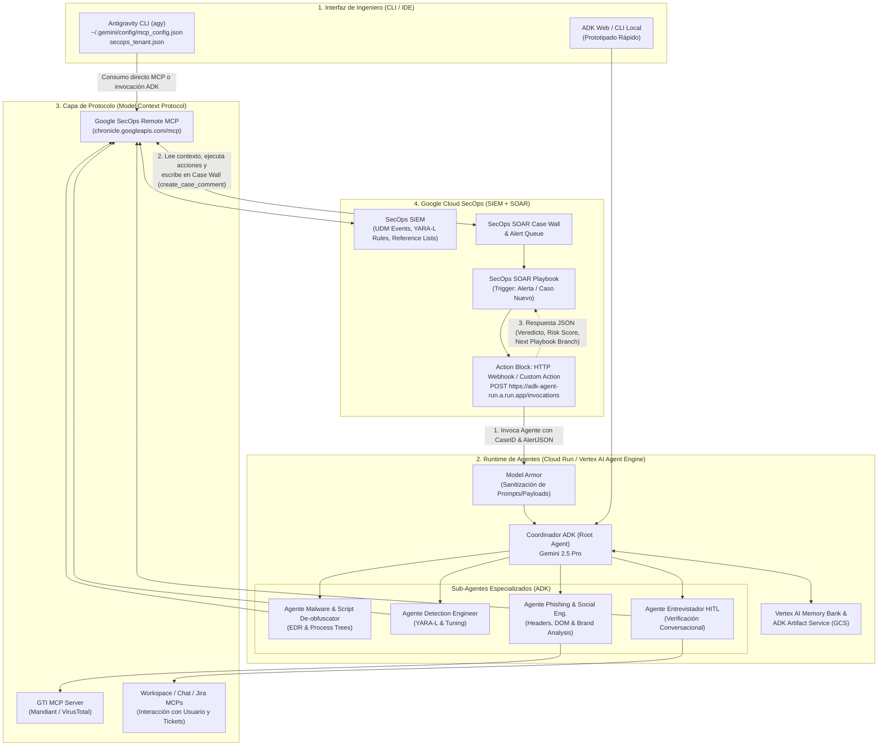

# Discovery de Casos de Uso: SOC Agentic AI con ADK, Antigravity CLI (`agy`) y Google Cloud SecOps

> **Autor:** Security Engineering Architecture & AI Agentic Team  
> **Enfoque:** Diseño de demos de alto impacto (PoC/MVP) combinando **Google Agent Development Kit (ADK)**, **Antigravity CLI (`agy`)**, **Model Context Protocol (MCP)** y **Google Security Operations (SecOps SIEM + SOAR)**.

---

## 1. Resumen Ejecutivo y Contexto del Estado del Arte

Actualmente, la integración entre Agentes de IA y **Google Cloud SecOps** ha evolucionado desde scripts estáticos hacia una arquitectura abierta basada en **Model Context Protocol (MCP)** (tanto mediante el repositorio open-source `google/mcp-security` como el servidor remoto administrado de Google `https://<region>-chronicle.googleapis.com/mcp`) y **Google ADK**.

### Lo que ya existe (Línea Base):
1. **Threat Hunting con AI Runbooks (`1c-X-igX7u0`):** Uso de runbooks prescriptivos (Agent Skills) donde un analista desde el CLI o IDE guía a un agente para buscar hipótesis de amenazas ejecutando búsquedas UDM (`udm_search`) y pivoteando sobre entidades.
2. **IoC Enrichment (`0tYP_iaW-8s`):** Correlación básica de indicadores (IPs, dominios, hashes) entre alertas de SecOps SIEM y **Google Threat Intelligence (GTI / Mandiant / VirusTotal)** para determinar reputación.

### El Salto de Valor para tus Demos (Hacia dónde vamos):
Para sorprender a clientes y equipos técnicos de SOC, pasamos de **"consultas asistidas"** a **patrones operativos reales del día a día de un SOC**:
* **Patrón A (Ingeniería y Operación desde Terminal con `agy` CLI + ADK):** El ingeniero de detección, Threat Hunter o SOC Lead opera desde su terminal con `agy` o `adk web` para automatizar el ciclo de vida de reglas YARA-L (con pruebas sintéticas), optimizar reglas ruidosas, convertir reportes de CTI en cacería retroactiva y generar reportes ejecutivos/post-mortems.
* **Patrón B (Event-Driven: Playbook de SecOps SOAR $\rightarrow$ Invoca Agente ADK):** Un caso o alerta entra a **Google SecOps SOAR**, dispara un Playbook determinista y, en un bloque de investigación compleja o validación ambigua, el Playbook invoca vía **Webhook / HTTP Action (o Custom Integration)** a un sistema Multi-Agente en **ADK (desplegado en Cloud Run o Vertex AI Agent Engine)**. El agente investiga autónomamente vía MCP, desofusca comandos, reconstruye ataques, entrevista usuarios o arma planes de contención, escribe el resultado en el *Case Wall* y devuelve un JSON estructurado para que el Playbook continúe la orquestación.

---

## 2. Arquitectura Técnica de Referencia

### 2.1. Ecosistema de Herramientas MCP Disponibles en Google SecOps
El servidor MCP oficial de Google SecOps (`https://us-chronicle.googleapis.com/mcp` y `google/mcp-security`) expone más de **65 herramientas nativas** agrupadas en dominios clave para nuestras demos:

| Dominio en SecOps MCP | Herramientas Clave (`tools/call`) | Potencial para Demos |
| :--- | :--- | :--- |
| **SIEM Search & Entity Context** | `udm_search`, `translate_udm_query`, `search_entity`, `summarize_entity`, `get_ioc_match`, `list_involved_entities` | Pivoteo autónomo entre logs, reconstrucción de línea de tiempo (Patient Zero) y traducción NL a UDM. |
| **Detection Engineering (YARA-L)** | `generate_rules`, `validate_rule`, `create_rule`, `list_rules`, `list_rule_errors`, `list_rule_detections`, `evaluate_rule_coverage`, `generate_synthetic_events`, `generate_threat_detection_opportunity` | Ciclo completo de ingeniería de detección autónoma: crear regla, inyectar logs sintéticos, probar cobertura y corregir errores. |
| **Data Tables & Reference Lists** | `create_data_table`, `add_rows_to_data_table`, `list_data_table_rows`, `create_reference_list`, `update_reference_list` | Gestión dinámica de listas blancas/excepciones, watchlists de usuarios VIP o IPs bloqueadas por agentes. |
| **SOAR Case & Alert Management** | `list_cases`, `get_case`, `update_case`, `create_case_comment`, `list_case_alerts`, `update_case_alert`, `execute_bulk_close_case` | Triage autónomo de casos, documentación forense en el *Case Wall* y actualización de prioridad/estado. |
| **SOAR Playbooks & Actions** | `list_playbooks`, `list_integration_actions`, `execute_manual_action`, `execute_actions`, `trigger_investigation`, `fetch_enrichment_actions` | Descubrimiento y ejecución remota de acciones de respuesta (aislar host en EDR, bloquear remitente, revocar sesión) desde un agente. |

---

### 2.2. Diagrama de Arquitectura: Integración Bidireccional (`agy` CLI + ADK + SecOps SOAR)



---

## 3. Catálogo de Casos de Uso Aprobados para Demos

> **Nota:** La especificación técnica detallada, diagramas de secuencia, contratos JSON y arquitectura de agentes ADK de estos 3 casos aprobados se encuentran en [UseCasesSpec.md](./UseCasesSpec.md).

### CATEGORÍA 1: Demos con `agy` CLI + ADK consumiendo Google SecOps

#### Caso de Uso 1.1 (`UC-01`): "Autonomous Purple Team & Detection-as-Code" (Generación, Simulación Sintética y Validación de Reglas YARA-L) ✅ *(Aprobado)*
* **Por qué es diferente a lo ya visto:** Va mucho más allá de buscar amenazas. Demuestra cómo un ingeniero de detección usa `agy` CLI o un agente multi-paso en ADK para convertir un TTP de MITRE ATT&CK en una regla YARA-L productiva **probada con telemetría sintética inyectada en tiempo real**.
* **Historia de la Demo (Storytelling):**
  1. Sale un nuevo TTP o técnica de ataque (ej. *Credential Dumping* o ejecución maliciosa vía tareas programadas).
  2. Desde `agy` CLI en la terminal, el ingeniero pide: *"Analiza si tenemos cobertura en SecOps para este comportamiento, genera la regla YARA-L, inyecta eventos sintéticos de ataque y de tráfico benigno para probarla, y dime si dispara correctamente"*.
  3. El agente orquesta el ciclo completo de Purple Team desde la terminal.
* **Herramientas MCP utilizadas:** `generate_threat_detection_opportunity`, `evaluate_rule_coverage_long_running`, `get_operation`, `generate_rules`, `validate_rule`, `generate_synthetic_events`, `create_rule`, `list_rule_detections`.

#### Caso de Uso 1.3 (`UC-02`): "SecOps Health & Rule Optimization Doctor" (Auditoría de Reglas Lentas y Tuning de Falsos Positivos desde CLI) ✅ *(Aprobado)*
* **El Dolor Real del SOC:** Las reglas YARA-L mal optimizadas fallan por timeout y las reglas ruidosas inundan la cola de alertas de SOAR con los mismos falsos positivos todos los días.
* **Historia de la Demo:**
  1. Desde `agy` CLI, el ingeniero ejecuta un comando o skill (`/secops-doctor`).
  2. El agente llama a `list_rule_errors` para encontrar reglas con timeouts de ejecución y revisa casos cerrados recientemente como Falsos Positivos (`list_cases`, `list_case_comments`).
  3. Identifica qué procesos o cuentas de servicio legítimas (ej. escáneres internos o scripts de backup) están disparando la regla, agrega la excepción limpia a una **Reference List** (`update_reference_list`), optimiza la consulta YARA-L y la valida con `validate_rule`.
* **Herramientas MCP utilizadas:** `list_rules`, `list_rule_errors`, `get_rule`, `validate_rule`, `list_cases`, `list_case_comments`, `get_reference_list`, `update_reference_list`.

---

### CATEGORÍA 2: Demos donde un Playbook de Google SecOps SOAR invoca Agentes de ADK

#### Caso de Uso 2.2 (`UC-03`): "Entrevistador Autónomo de Usuarios (Human-in-the-Loop Conversacional)" desencadenado por Playbook SOAR ✅ *(Aprobado)*
* **El Problema Clásico del SOC:** Cuando una alerta requiere confirmar con el empleado si una acción fue legítima (ej. descarga masiva de archivos, login desde otro país, instalación de una app OAuth o ejecución de herramienta de administración), el SOC pierde horas esperando respuesta o usa botones rígidos (`Sí/No`) que un atacante puede manipular.
* **Cómo funciona la Demo (Playbook $\rightarrow$ ADK):**
  1. **Trigger en SecOps SOAR:** Alerta de comportamiento inusual de usuario o exfiltración en Google Workspace / Endpoint.
  2. **Invocación:** El Playbook de SOAR llama al **Agente ADK `ConversationalVerifier`**.
  3. **Trabajo Autónomo del Agente ADK:**
     * Inicia un chat en lenguaje natural (Google Chat / Slack) con el usuario involucrado.
     * Evalúa las respuestas del usuario en tiempo real **contrastándolas con los logs de `udm_search`** (ej. el usuario dice *"Sí, fui yo desde mi casa en Lima"*, pero el agente ve en `udm_search` que la sesión se originó en un VPS en Europa y ejecutó un comando de exfiltración).
     * Incluye **Model Armor** para bloquear intentos de *Prompt Injection* si el atacante secuestró el chat del empleado e intenta engañar al agente del SOC.
  4. **Retorno al Playbook SOAR:** Documenta la transcripción y las contradicciones halladas en el *Case Wall* (`create_case_comment`) y devuelve al Playbook la orden de bloquear la cuenta o cerrar el caso.

---

## 4. Justificación de Valor para el Negocio y el SOC: Frecuencia, Mundo Sin IA vs. Mundo con ADK + MCP + SecOps

Esta sección resume el **argumento comercial y operativo** para presentar estos 8 casos ante un CISO, SOC Manager o líder de SecOps:

### 4.1. Comparativa Caso por Caso: Frecuencia del Problema y Solución Tradicional (Sin IA) vs. Con Agentes

#### A. Casos de Ingeniería y Operación desde Terminal (`agy` CLI + ADK)

##### 1. Autonomous Purple Team & Detection-as-Code (`UC-01`)
* **¿Qué problema resuelve?** El tiempo que toma crear y **probar con datos reales** una regla YARA-L ante una nueva amenaza.
* **¿Qué tan frecuente es?** **Semanal / Diario.** Cada vez que sale un aviso de amenaza nuevo.
* **¿Cómo se resuelve HOY sin IA?**
  * El ingeniero escribe la regla YARA-L a mano, pero como no hay un ataque activo ocurriendo en ese segundo en los logs, el test devuelve `0 detections`. Para saber si la regla realmente sirve, debe levantar VMs de laboratorio, ejecutar herramientas de ataque (*Atomic Red Team*), esperar que los logs lleguen al SIEM o armar JSONs a mano. **Toma de 4 horas a 2 días por regla.**
* **El Beneficio con `agy` + ADK + SecOps MCP:**
  * El agente escribe la regla, **genera e inyecta logs sintéticos de ataque y benignos** (`generate_synthetic_events`), evalúa la cobertura (`evaluate_rule_coverage_long_running`), y verifica que la regla compile y dispare la alerta en **menos de 3 minutos**.

##### 2. SecOps Health & Rule Optimization Doctor (`UC-02`)
* **¿Qué problema resuelve?** La fatiga de alertas por reglas ruidosas (falsos positivos repetitivos) y reglas que fallan silenciosamente por timeouts.
* **¿Qué tan frecuente es?** **Diario.** Entre el 10% y 25% de las reglas de cualquier SIEM generan falsos positivos recurrentes que Tier 1 cierra mecánicamente todos los días.
* **¿Cómo se resuelve HOY sin IA?**
  * Una vez al mes se exporta un reporte de tickets cerrados, un ingeniero lee manualmente los comentarios de los analistas para adivinar qué servidor o script interno causó el falso positivo, y edita la regla o lista de exclusión a mano.
* **El Beneficio con `agy` + ADK + SecOps MCP:**
  * Con un comando en CLI, el agente audita errores de compilación/ejecución (`list_rule_errors`) y comentarios de casos cerrados (`list_case_comments`), proponiendo y aplicando el *tuning* en *Reference Lists* en minutos.

---

#### B. Caso donde el Playbook de Google SecOps SOAR invoca Agentes de ADK

##### 3. Entrevistador Autónomo de Usuarios con Verificación Cruzada (`UC-03`)
* **¿Qué problema resuelve?** Confirmar con el empleado si una actividad inusual fue legítima sin perder horas de analista ni caer en engaños de atacantes.
* **¿Qué tan frecuente es?** **Diario (20% al 40% de alertas de DLP, accesos remotos o cambios de configuración).**
* **¿Cómo se resuelve HOY sin IA?**
  * O un analista humano persigue al usuario por Slack/Chat durante horas, o el SOAR manda un mensaje rígido con dos botones (`[Sí fui yo]` / `[No fui yo]`). Si el atacante comprometió la sesión del empleado, presiona `[Sí fui yo]` y el SOAR cierra el incidente.
* **El Beneficio con Playbook SOAR $\rightarrow$ Agente ADK + Model Armor:**
  * El Agente ADK entrevista al usuario en lenguaje natural y **verifica sus respuestas en vivo contra `udm_search`**. Si lo que dice el usuario contradice los logs técnicos (o si intenta un *Prompt Injection* detenido por **Model Armor**), el agente detecta la mentira y ordena al Playbook bloquear la cuenta.

---

### 4.2. Tabla Resumen de Impacto Operativo (Para Presentaciones Ejecutivas)

| Caso de Uso Aprobado | Frecuencia en el SOC | Proceso Tradicional (Sin IA / SOAR Estático) | Con `agy` CLI + ADK + SecOps MCP |
| :--- | :--- | :--- | :--- |
| **UC-01: Purple Team & Reglas YARA-L** | Semanal / Diario | 4 horas a 2 días (sin logs sintéticos para validar) | **< 3 minutos** (con inyección sintética en UDM) |
| **UC-02: Rule Optimization & Tuning Doctor** | Diario (10-25% de reglas ruidosas) | Auditoría mensual manual de tickets cerrados | **1 comando diario** (actualiza Reference Lists) |
| **UC-03: Entrevistador de Usuario (HITL)** | Diario (20-40% de alertas) | Horas de espera o botones `Sí/No` vulnerables | **Minutos** (chat contrastado en vivo con UDM) |

---

## 5. Guía Práctica de Implementación Técnica

### 5.1. Configuración de `agy` CLI para consumir Google Cloud SecOps MCP

**Paso 1: Habilitar el MCP remoto y autenticar ADC**
```bash
gcloud beta services mcp enable chronicle.googleapis.com/mcp --project=TU_PROJECT_ID
gcloud auth application-default login --scopes="https://www.googleapis.com/auth/cloud-platform,https://www.googleapis.com/auth/chronicle"
```

**Paso 2: Configurar `~/.gemini/config/mcp_config.json`**
```json
{
  "mcpServers": {
    "google-cloud-secops": {
      "serverUrl": "https://us-chronicle.googleapis.com/mcp",
      "authProviderType": "google_credentials",
      "oauth": {
        "scopes": [
          "https://www.googleapis.com/auth/cloud-platform",
          "https://www.googleapis.com/auth/chronicle"
        ]
      },
      "timeout": 300000
    }
  }
}
```

**Paso 3: Contexto del Tenant en tu carpeta de trabajo (`secops_tenant.json`)**
```json
{
  "customer_id": "TU_CHRONICLE_CUSTOMER_UUID",
  "project_id": "TU_GCP_PROJECT_ID",
  "region": "us"
}
```

---

### 5.2. Esqueleto del Agente en Google ADK conectado a SecOps MCP

```python
import os
import google.auth
import google.auth.transport.requests
from google.adk.agents import Agent
from google.adk.tools.mcp_tool import McpToolset, StreamableHTTPConnectionParams

def get_access_token() -> str:
    credentials, _ = google.auth.default(
        scopes=[
            "https://www.googleapis.com/auth/cloud-platform",
            "https://www.googleapis.com/auth/chronicle",
        ]
    )
    credentials.refresh(google.auth.transport.requests.Request())
    return credentials.token

PROJECT_ID = os.environ.get("GCP_PROJECT_ID", "tu-project-id")
CUSTOMER_ID = os.environ.get("SECOPS_CUSTOMER_ID", "tu-customer-uuid")
REGION = os.environ.get("SECOPS_REGION", "us")

secops_mcp = McpToolset(
    connection_params=StreamableHTTPConnectionParams(
        url=f"https://{REGION}-chronicle.googleapis.com/mcp",
        headers={
            "Authorization": f"Bearer {get_access_token()}",
            "Accept": "text/event-stream",
            "x-goog-user-project": PROJECT_ID,
        },
    )
)

triage_agent = Agent(
    name="secops_triage_specialist",
    model="gemini-2.5-flash",
    tools=[secops_mcp],
    instruction=f"""Eres un analista forense de Tier 2/3 en el SOC.
    Para todas las llamadas a herramientas de SecOps usa siempre:
    - project_id: {PROJECT_ID}
    - customer_id: {CUSTOMER_ID}
    - region: {REGION}
    
    Cuando un Playbook de SOAR te invoque con un case_id o alert_id:
    1. Obtén los detalles del caso y sus alertas (get_case, list_case_alerts).
    2. Desofusca líneas de comando, reconstruye el árbol de procesos o busca el Paciente Cero con udm_search.
    3. Documenta tus hallazgos técnicos en el muro del caso usando create_case_comment.
    4. Devuelve un JSON estructurado con verdict, confidence y recommended_soar_action.
    """,
)

root_agent = Agent(
    name="soc_orchestrator_agent",
    model="gemini-2.5-pro",
    sub_agents=[triage_agent],
    instruction="""Coordina investigaciones de incidentes invocadas por Playbooks de Google SecOps SOAR
    o por ingenieros desde la CLI. Sintetiza la respuesta final en JSON estricto cuando el caller sea un Playbook.""",
)
```

---

### 5.3. Patrones de Invocación desde el Playbook de Google SecOps SOAR hacia ADK

1. **Vía Webhook / HTTP Integration Block (Síncrono con Ramificación Condicional):**
   * El Playbook de SOAR hace un `POST` al servicio Cloud Run donde corre tu agente ADK enviando `[Case.Id]`, `[Alert.Identifier]` y `[Entity.Identifier]`.
   * El Agente ADK investiga vía MCP, comenta en el *Case Wall* y responde un JSON (`{"verdict": "MALICIOUS", "action": "ISOLATE"}`).
   * Un bloque `Condition` en el Playbook de SOAR evalúa la respuesta JSON del agente y ejecuta la rama de contención en el EDR/Active Directory/Email.
2. **Vía Custom Action en el IDE de SecOps SOAR (`Bring Your Own Agent`):**
   * Creas una acción en Python dentro del IDE de SOAR que invoca tu agente en Vertex AI Agent Engine / Cloud Run y renderiza un **Widget HTML** nativo dentro de la vista del caso en SOAR.
3. **Vía Asíncrona con Callback por MCP (Para entrevistas HITL o cacerías largas):**
   * El Playbook dispara el agente ADK y termina su ejecución inicial; cuando el agente termina de entrevistar al usuario por Chat o de reconstruir el Paciente Cero, utiliza las herramientas del **SecOps MCP** (`create_case_comment`, `update_case`, `execute_manual_action`) para empujar la actualización de regreso a SOAR.
