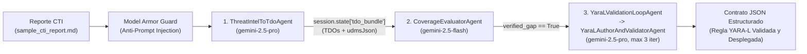

# UC-01: Autonomous Purple Team & Detection-as-Code (`uc01_purple_team_agent`)

> **Modalidad:** Ingeniería de Detección y Purple Team desde Terminal (`agy` CLI / `adk web` / `demo_cli.py`) $\rightarrow$ **Google Cloud SecOps Remote MCP** (`https://us-chronicle.googleapis.com/mcp`)  
> **Técnicas MITRE ATT&CK cubiertas en la Demo:** `T1003.001` (Volcado de memoria de LSASS vía `rundll32.exe` y `comsvcs.dll` `MiniDump` / `#24`) y `T1053.005` (Persistencia mediante Tareas Programadas `schtasks.exe /create`).

---

## 1. Descripción General y Valor Operativo

En un flujo tradicional sin IA, convertir un boletín de *Threat Intelligence* (CTI) en una regla **YARA-L 2.0** productiva y probada con telemetría real toma entre **4 horas y 2 días** (levantar máquinas virtuales de laboratorio, ejecutar *Atomic Red Team*, esperar la ingesta en el SIEM y depurar errores de compilación).

Con **UC-01 (`uc01_purple_team_agent`)**, el ingeniero de detección ejecuta el ciclo completo de **Purple Team & Detection-as-Code en menos de 3 minutos**:
1. **Defensa contra Prompt Injection (Model Armor):** Sanitiza el boletín CTI de entrada antes de procesarlo.
2. **Extracción de Threat Detection Opportunities (TDO):** Llama a `generate_threat_detection_opportunity` para estructurar las oportunidades de detección.
3. **Generación de Telemetría UDM Sintética (`udmsJson`):** Llama a `generate_synthetic_events` para sintetizar eventos `PROCESS_LAUNCH` en formato UDM sin doble escape JSON.
4. **Evaluación Asíncrona de Cobertura:** Ejecuta `evaluate_rule_coverage_long_running`, hace *polling* con `get_operation` y verifica el estado de las reglas actuales con `get_rule` (aplicando la regla crítica de Protobuf-JSON donde la ausencia del campo booleano `alertingEnabled` se interpreta estrictamente como `false`).
5. **Autoría, Auto-Corrección y Despliegue de Reglas YARA-L 2.0:** Donde confirma una brecha de cobertura (`verified_gap: true`), genera la regla YARA-L 2.0 (`generate_rules`), valida su compilación en el backend (`validate_rule` con bucle de auto-corrección de hasta 3 iteraciones), evalúa el ruido histórico de las últimas 72 horas (`list_rule_detections`) y despliega la regla (`create_rule` + verificación con `get_rule`).

---

## 2. Arquitectura Multi-Agente en Google ADK



| Agente ADK | Modelo | Herramientas SecOps MCP | Responsabilidad Clave |
| :--- | :--- | :--- | :--- |
| **`ThreatIntelToTdoAgent`** | `gemini-2.5-pro` | `generate_threat_detection_opportunity`, `generate_synthetic_events` | Sanitiza la entrada, extrae los objetos TDO y genera el arreglo `udmsJson` sin doble escape en `session.state["tdo_bundle"]`. |
| **`CoverageEvaluatorAgent`** | `gemini-2.5-flash` | `evaluate_rule_coverage_long_running`, `evaluate_rule_coverage`, `get_operation`, `get_rule` | Evalúa el corpus de reglas contra los eventos sintéticos y normaliza `alertingEnabled` omitido en Protobuf como `False`. |
| **`YaraLAuthorAndValidatorAgent`** | `gemini-2.5-pro` | `generate_rules`, `validate_rule`, `list_rule_detections`, `create_rule`, `get_rule` | Genera código YARA-L 2.0, corrige errores de sintaxis/campos UDM hasta compilar (`SUCCEEDED`), valida `0` falsos positivos en 72h y despliega. |

---

## 3. Estructura de Archivos del Módulo

```text
uc01_purple_team_agent/
├── __init__.py             # Expone root_agent para `adk web` y `adk run`
├── agent.py                # Definición de los agentes ADK, herramientas MCP y pipeline determinista
├── sample_cti_report.md    # Boletín CTI realista sobre T1003.001 (LSASS comsvcs.dll) y T1053.005 (schtasks)
├── SKILL.md                # Skill para Antigravity CLI (`agy`)
├── demo_cli.py             # Ejecutor interactivo de terminal paso a paso
└── README.md               # Esta documentación en español
```

---

## 4. Cómo Ejecutar la Demo (`UC-01`)

### Opción A: Ejecución inmediata desde Terminal con `demo_cli.py` (Modo Demo Autónomo)

Desde el directorio raíz del repositorio (`./`):

```bash
# Ejecuta el flujo completo paso a paso con salida enriquecida en terminal
python3 -m uc01_purple_team_agent.demo_cli

# Opcional: Imprimir únicamente el contrato JSON final (Sección 4.4 de UseCasesSpec.md)
python3 -m uc01_purple_team_agent.demo_cli --json-only
```

### Opción B: Ejecución desde Antigravity CLI (`agy`) usando `SKILL.md` (Instalación Global y Prompts)

1. **Instalar la Skill de forma global** para que `agy` la descubra desde cualquier directorio de tu máquina:
   ```bash
   # Desde la raíz del repositorio (./):
   mkdir -p ~/.gemini/config/skills/uc01-autonomous-purple-team
   ln -sfn "$(pwd)/uc01_purple_team_agent/SKILL.md" ~/.gemini/config/skills/uc01-autonomous-purple-team/SKILL.md

   # Verificar el enlace simbólico global:
   ls -l ~/.gemini/config/skills/uc01-autonomous-purple-team/SKILL.md
   ```
2. Asegúrate de tener configurado `~/.gemini/config/mcp_config.json` (a partir de `./mcp_config.example.json`) y `./secops_tenant.json` (a partir de `./secops_tenant.example.json`).
3. Inicia `agy` y prueba cualquiera de los siguientes **Prompts de Ejemplo**:

   * **Prompt 1 — Flujo Purple Team End-to-End desde Boletín CTI:**
     ```text
     Usa la skill uc01-autonomous-purple-team para analizar ./uc01_purple_team_agent/sample_cti_report.md, extraer las oportunidades de detección (TDO), generar eventos UDM sintéticos para T1003.001 y T1053.005, evaluar brechas de cobertura en nuestro SIEM y compilar/validar la regla YARA-L 2.0 con validate_rule.
     ```
   * **Prompt 2 — Simulación de Técnica MITRE ATT&CK Específica y Validación de Ruido Histórico (72h):**
     ```text
     Con la skill uc01-autonomous-purple-team, simula la técnica MITRE T1003.001 (volcado de memoria de LSASS ejecutando rundll32.exe comsvcs.dll, MiniDump). Comprueba si alguna regla activa con alertingEnabled=true la detecta; si hay brecha de cobertura, redacta la regla YARA-L 2.0, valida su sintaxis en el backend MCP y verifica que produzca 0 falsos positivos en las últimas 72 horas antes de desplegarla.
     ```
   * **Prompt 3 — Generación y Auto-Corrección de Regla YARA-L 2.0 en Modo Prueba (`alertingEnabled=false`):**
     ```text
     Usando uc01-autonomous-purple-team, genera una regla YARA-L 2.0 para detectar persistencia con tareas programadas (schtasks.exe /create /sc minute - MITRE T1053.005), pásala por validate_rule hasta que compile sin errores y muéstrame el contrato JSON resultante.
     ```

### Opción C: Ejecución Interactiva con Google ADK (`adk web` / `adk run`) y Prompts de Ejemplo

```bash
# (Opcional) Para conectarse al tenant real de Google Cloud SecOps vía MCP en lugar del modo Mock:
export SECOPS_MOCK_MODE=false
export GCP_PROJECT_ID="<YOUR_GCP_PROJECT_ID>"
export SECOPS_CUSTOMER_ID="<YOUR_CHRONICLE_CUSTOMER_UUID>"
export SECOPS_REGION="us"

# Iniciar la interfaz web de ADK o consola interactiva desde la raíz del repositorio:
adk web .
# o bien:
adk run uc01_purple_team_agent
```

Una vez abierta la interfaz de **`adk web`** en tu navegador (`http://localhost:8000`), selecciona el agente **`uc01_purple_team_agent`** y utiliza cualquiera de estos **Prompts de Ejemplo**:

* **Prompt A — Pipeline Completo de Purple Team sobre el Reporte CTI:**
  ```text
  Analiza el reporte CTI de volcado de credenciales LSASS (T1003.001 vía comsvcs.dll) y tareas programadas (T1053.005). Genera los eventos UDM sintéticos sin doble escape JSON, evalúa la cobertura actual de nuestras reglas en Google SecOps y genera una regla YARA-L 2.0 validada con validate_rule para cerrar la brecha.
  ```
* **Prompt B — Evaluación de Brecha de Cobertura y Validación Sintáctica sin Despliegue:**
  ```text
  Ejecuta el ejercicio de Purple Team en modo solo validación (deploy_rule=False) para T1003.001 y muéstrame los eventos udmsJson generados, las reglas existentes evaluadas y el código YARA-L 2.0 validado.
  ```

---

## 5. Contrato de Salida JSON (`UseCasesSpec.md` Sección 4.4)

```json
{
  "use_case": "UC-01_Autonomous_Purple_Team",
  "tdo_summary": "Detección de volcado de memoria de LSASS mediante rundll32.exe y comsvcs.dll (MITRE T1003.001)",
  "synthetic_events_generated": 3,
  "existing_coverage": [],
  "verified_gap": true,
  "generated_rule": {
    "rule_name": "rundll32_comsvcs_lsass_memory_dump",
    "mitre_attack": [
      "T1003.001"
    ],
    "severity": "High",
    "syntax_validated": true,
    "historical_noise_72h": 0,
    "deployed_rule_id": "ru_8a92b110-4c12-49e0-9b1a-7712390abcde",
    "alerting_enabled": false
  }
}
```
