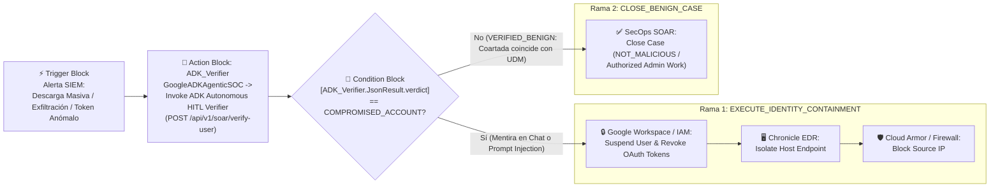

# Guía de Configuración del Playbook en Google Cloud SecOps SOAR (`UC-03`)

> **Importante:** El Caso de Uso 3 (`UC-03`) **se dispara directamente desde un Playbook de Google Cloud SecOps SOAR** cuando ingresa una alerta que requiere validación contextual con el empleado involucrado.

---

## 1. Flujo Visual del Playbook en el Diseñador de SecOps SOAR



---

## 2. Paso a Paso para Instalar la Acción Personalizada en SecOps SOAR IDE

1. En la consola de **Google Cloud SecOps**, navega a **SOAR > Response > IDE**.
2. Haz clic en el botón **`+` (Add New Item)** y selecciona **Action**:
   * **Name:** `Invoke ADK Autonomous HITL Verifier`
   * **Integration:** `GoogleADKAgenticSOC` (o tu integración custom de SOC)
3. Copia y pega el contenido íntegro de [`soar_custom_action_ide.py`](./soar_custom_action_ide.py) en el editor.
4. Configura los parámetros de entrada de la acción en la pestaña **Parameters**:
   * `ADK Cloud Run Endpoint URL`: `https://adk-soar-hitl-verifier-uc03.a.run.app/api/v1/soar/verify-user`
   * `GCP Project ID`: ID del proyecto GCP de SecOps
   * `Chronicle Customer UUID`: UUID del tenant de Chronicle
   * `SecOps Region`: `us`
   * `OIDC Bearer Token`: Token OIDC o cuenta de servicio para invocar Cloud Run (`roles/run.invoker`)
   * `Execution Mode`: `SYNC_DEMO`
5. Haz clic en **Save** y activa el interruptor **Enabled**.

---

## 3. Configuración de Bloques en el Playbook Designer

### Bloque 1: Trigger
* **Tipo:** `Alert Trigger Value`
* **Condición:** `RuleGenerator CONTAINS "Anomalous Mass Cloud Storage & Confidential File Exfiltration"` (o las reglas que requieran verificación humana HITL).

### Bloque 2: Action (`ADK_Verifier`)
* Arrastra la acción **`Invoke ADK Autonomous HITL Verifier`** (o un bloque estándar `HTTP_V2 > Post Request`) y nómbralo `ADK_Verifier`.
* Payload JSON enviado al servicio ADK:
  ```json
  {
    "soar_context": {
      "project_id": "tu-gcp-project-id",
      "customer_id": "tu-chronicle-customer-uuid",
      "region": "us",
      "case_id": "[Case.Id]",
      "alert_id": "[Alert.Identifier]",
      "alert_name": "[Alert.Name]",
      "rule_id": "[Alert.RuleId]"
    },
    "entity_to_verify": {
      "user_email": "[Entity.Identifier]",
      "hostname": "[Alert.PrincipalHostname]",
      "source_ip": "[Alert.PrincipalIp]"
    },
    "execution_mode": "SYNC_DEMO"
  }
  ```

### Bloque 3: Condition (`Evaluate_ADK_Verdict`)
* Configura las dos ramas evaluando el `JsonResult` devuelto por `ADK_Verifier`:
  * **Rama 1 (`EXECUTE_IDENTITY_CONTAINMENT`):**
    * `[ADK_Verifier.JsonResult.verdict]` **Equals** `COMPROMISED_ACCOUNT`
    * **OR** `[ADK_Verifier.JsonResult.prompt_injection_detected]` **Equals** `true`
    * **Acciones conectadas:**
      1. `Suspend User` sobre `[ADK_Verifier.JsonResult.containment_targets.suspend_user]`
      2. `Isolate Endpoint` sobre `[ADK_Verifier.JsonResult.containment_targets.isolate_hostname]`
      3. `Block IP` sobre `[ADK_Verifier.JsonResult.containment_targets.block_ip]`
  * **Rama 2 (`CLOSE_BENIGN_CASE`):**
    * `[ADK_Verifier.JsonResult.verdict]` **Equals** `VERIFIED_BENIGN`
    * **Acción conectada:**
      1. `Close Case` (`Reason = NOT_MALICIOUS`, `Root Cause = Authorized Admin Work`).
